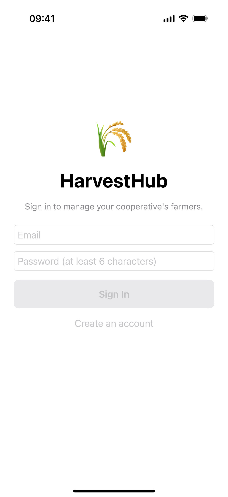
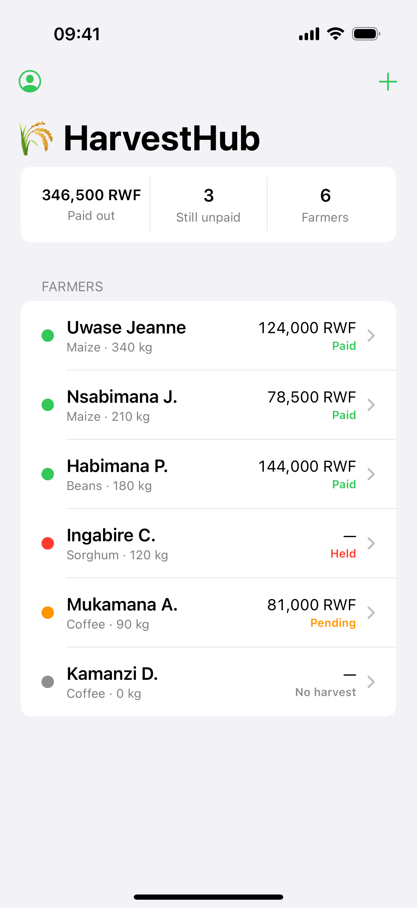
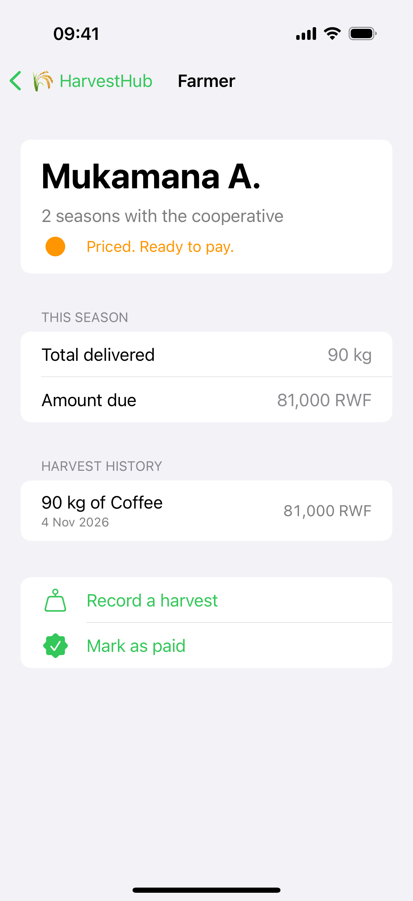
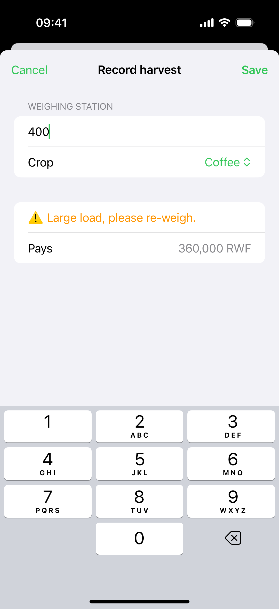

# 🌾 HarvestHub

A cooperative harvest-and-payout app that records every kilo a farmer delivers and pays every farmer fairly and on time.

Built with SwiftUI and Firebase for Cohort 2 of the AUCA SwiftUI Program.

## What it does

- Shows the cooperative's farmers, ranked by how much they delivered this season
- Colour-codes each farmer: green when paid, amber when pending, red when a payment is held
- Works out exactly what each farmer is owed: kilos × crop price, plus a loyalty bonus for members with 3+ seasons
- Holds a payment safely when a farmer brings a crop that has no price yet (no guessing with people's money)
- Tap a farmer to see their full harvest history, record a new harvest, or mark them as paid
- Season summary at the top: total paid out, farmers still unpaid, and farmer count
- Each cooperative officer signs in and sees only their own farmers
- Data is saved in the cloud with Firebase Firestore and stays in sync live

## Screenshots

| Sign in | Farmers | Farmer detail | Record a harvest |
|---|---|---|---|
|  |  |  |  |

The screenshots are generated by the `ReadmeScreenshotTests` UI test, which signs in, loads the sample farmers, opens a farmer, and records a harvest.

## How it works

HarvestHub follows **MVVM**: *Model is the truth, ViewModel is the bridge, View is the face.*

| Layer | Files | Job |
|---|---|---|
| Model | `Farmer`, `Harvest`, `HarvestStatus`, `PayoutEngine` | The rules: prices, payouts, loyalty bonus, and the harvest lifecycle (logged → priced → paid, or held) |
| ViewModel | `CoopViewModel`, `AuthViewModel` | Listens to Firestore for the signed-in officer's farmers, saves changes, and handles sign in / sign out |
| View | `RootView`, `LoginView`, `FarmerListView`, `FarmerDetailView`, `AddFarmerView`, `RecordHarvestView` | The screens: sign in, the farmer list, a farmer's detail, and forms to add a farmer or record a harvest |

Security: every farmer document is stamped with the `ownerID` of the officer who registered it, and the [Firestore rules](firestore.rules) only let a signed-in officer read or change their own farmers.

## Built with

- Swift and SwiftUI
- MVVM architecture (Model, View, ViewModel)
- Firebase Authentication and Cloud Firestore

## How to run

1. Clone this repository
2. Open `HarvestHub.xcodeproj` in Xcode 16.2 or newer
3. In your Firebase project, add an iOS app with the bundle id `ac.rw.HarvestHub`, download `GoogleService-Info.plist`, and drop it into the `HarvestHub/` folder
4. In the Firebase console, enable **Authentication ▸ Email/Password**, create a **Firestore Database**, and publish the rules from [`firestore.rules`](firestore.rules)
5. Press Run, create an account, and tap **Load sample farmers** to try it out

Tests: press **Cmd+U** in Xcode. `HarvestHubTests` checks the payout maths and the harvest lifecycle; `ReadmeScreenshotTests` walks through the app end to end.

## Author

Mukunzi Jonathan
AUCA SwiftUI Program, Cohort 2
